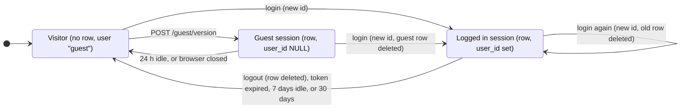
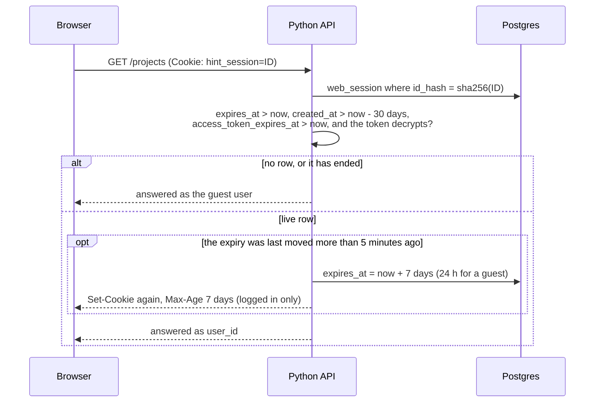
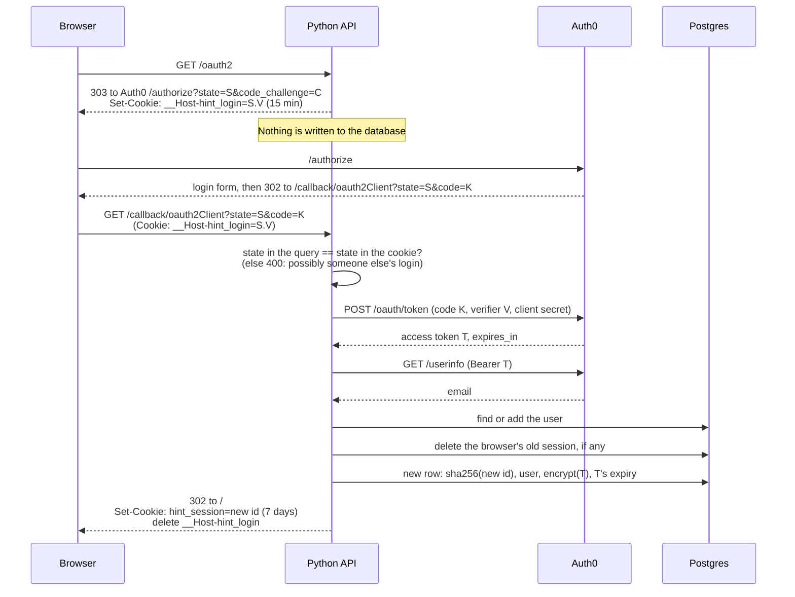

# Login and sessions

How the Python API knows who is using the app: guests, logged in users, the cookies, the timeouts, and the Auth0 token
used to call ADR. The code is in `hint-py/app/routers/login.py`, `hint-py/app/services/web_sessions.py` and
`hint-py/app/clients/auth0_client.py`.

## Who is who

| Visitor | Session row | `hint_session` cookie | Session ends | ADR is called with |
|---|---|---|---|---|
| New visitor, or one whose session has ended | none | none | n/a | nothing (ADR needs a login) |
| Guest who has started work (`POST /guest/version`) | yes, `user_id` NULL, plus one `web_session_guest_version` row per version | browser-session cookie: deleted when the browser closes | 24 h after its last use, or when the browser closes | nothing |
| User logged in with Auth0 (deployed) | yes, with the encrypted access token and when it expires | persistent, `Max-Age` 7 days, sent again when the expiry moves | when Auth0's access token expires (24 h after the login), 7 days after its last use, 30 days after the login at most, or at logout | their Auth0 access token |
| User logged in with the dev login (development) | yes, no token | persistent, as above | 7 days after its last use, 30 days after the login at most, or at logout | `HINT_ADR_API_KEY` (or `ADR_TEST_KEY`) |

The cookie holds a random id (`secrets.token_urlsafe(32)`). The table holds only its SHA-256, so a copy of the table cannot
be used to log in. The cookie is `HttpOnly` (no script can read it), `SameSite=Lax`, and `Secure` on https.

## A request

Moving `expires_at` at most every 5 minutes means most requests read and do not write. The row is never extended past 30
days after the login.

## Logging in with Auth0

- **The `state`** stops "login CSRF": someone logs in to Auth0 as themselves, keeps the callback address with their code,
  and gets your browser to open it. Your browser has no login cookie with that state, so it is refused. Without the
  check you would be logged in as them, and your data would go into their account.
- **PKCE** (the verifier `V` and its challenge `C`): a code that is stolen on its way back (from a log, the browser's
  history) is no use without `V`, and only this browser's cookie has it.
- **The login cookie** is separate from the session, so a login that is started and never finished leaves nothing in
  the database. On https its name has the `__Host-` prefix, so no other site under the same domain can set it.
- **A new id at each login**: an id someone had before the login (for example one planted in the browser) is no use
  after it.
- `GET /register` is the same, with Auth0's sign-up screen.

In development there is no Auth0: the login page has a button for each user in `HINT_DEV_USERS`, which posts to
`POST /dev-login` and makes a session the same way, with no token.

## The Auth0 token and ADR

The access token is stored encrypted (Fernet, keys in `HINT_SESSION_ENCRYPTION_KEYS`, never in the database). ADR is
called with it as the user. Auth0 sets how long it works (`expires_in`): the tenant's "Maximum Access Token Lifetime" of
the API, 24 hours. (The "Implicit / Hybrid Flow Access Token Lifetime" is for tokens that `/authorize` gives straight to
the browser. This app gets its token from `/oauth/token`, so that setting does not apply.)

**The session ends when the token expires**, whatever the idle and 30 day limits say. The user is then a guest: an
endpoint that needs a login answers 401, and the Vue app sends them to `/login?error=SessionExpired`. Auth0 usually still
has its own session, so logging in again is one click, and gives a new session and a new token. A token that no key
decrypts (its key was removed from `HINT_SESSION_ENCRYPTION_KEYS`) ends the session the same way.

So a single sign-on user logs in once a day. The limit is Auth0's setting, not a number in this app: a longer token
lifetime in Auth0 makes longer sessions, up to the 7 day idle and 30 day limits. Sessions that last longer than the
token, without a new login, would need refresh tokens (`offline_access`), which this app does not ask for.

## The timeouts, in examples

- **Idle for 5 hours, browser left open or closed and opened again:** a logged in user is still logged in (within the
  token's 24 hours for single sign-on) (the cookie is
  persistent, the row lasts 7 days after the last use). The same row is used, and its expiry moves on at the next
  request. A guest who closed the browser has lost the cookie, so starts as a new visitor.
- **Not used for 7 days:** the row has expired. The user is a guest until they log in, which makes a new row, a new id
  and (with Auth0) a new token.
- **Used every day for a month:** the session ends 30 days after the login anyway.
- **A single sign-on user, 24 hours after the login:** the token has expired, so the session has ended, even if they
  used it a minute ago. They log in again.
- **Logout:** the row is deleted and the cookie is removed. A user who logged in with Auth0 is sent to Auth0's logout
  too, or Auth0 would log them straight back in.
- **User A logs out and user B logs in on the same browser:** A's row is gone at the logout. B's login makes a new row
  and id. If A did not log out, B's login deletes A's row.

## Guests and their versions

A guest has no projects. Each tab asks `POST /guest/version` for a project version of its own, and the session lists the
versions it was given (`web_session_guest_version`). A guest's request on a version (`X-Version-Id`) is refused unless the
version is in that list: version ids are hard to guess, but the list, not the id, is what keeps one guest out of
another's files. The list rows are deleted with their session row (`ON DELETE CASCADE`).

At a login, the guest's session row (and so its list) is deleted, and the versions are no longer anyone's.

## Clean-up

Rows are deleted at logout and when a login replaces a session. A row that has expired stays in the table, but lets
nobody in, as every read checks the expiry. Deleting them, and the guest versions no session lists, is for the scheduled
maintenance job (target design R9), which is not written yet.
